# Bravada for Astro

[](https://emdashcms.com)
[](https://astro.build)
[](https://nodejs.org)
[](https://github.com/vhscom/emdash-theme-bravada/actions/workflows/ci.yml)
[](./LICENSE)

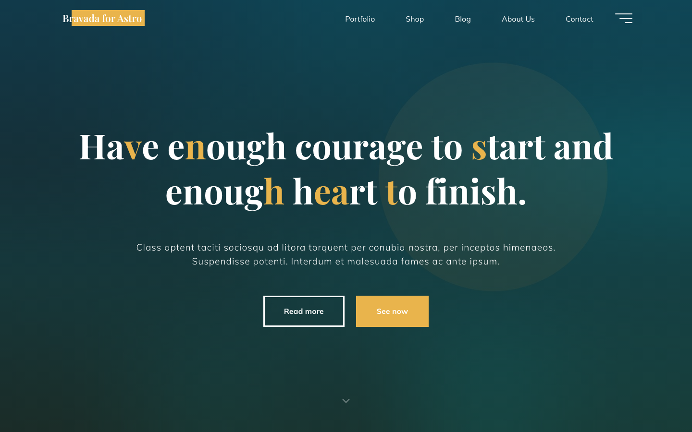

**Live demo:** [bravada.comfus.io](https://bravada.comfus.io)

A port of the
[Bravada](https://www.cryoutcreations.eu/wordpress-themes/bravada) WordPress
theme (Cryout Creations) to [Astro](https://astro.build), powered by
[EmDash](https://emdashcms.com) and built on the EmDash blog template. Runs on
any Node.js server with SQLite and local file storage.

The port carries Bravada's visual language — Playfair Display headings over
Mulish body text, the teal/gold palette, the gold-ribbon wordmark, highlighter
title sweeps, ghost section headers, the slow zoom-under-teal image hover, the
dark footer — and builds its **landing page from EmDash marketing blocks**:
bands an editor adds, reorders and configures from a form in the admin,
without touching code.

Most of the demo imagery — heroes, headers, shop and portfolio photography —
is real CC0/CC BY photography rather than placeholder art, with some
generated CC0 artwork remaining; see [CREDITS.md](./CREDITS.md) for the full
attribution table. Local images ship with pre-built AVIF/WebP siblings
served through `<picture>` for the hero, page headers, portfolio, and
project-grid images.

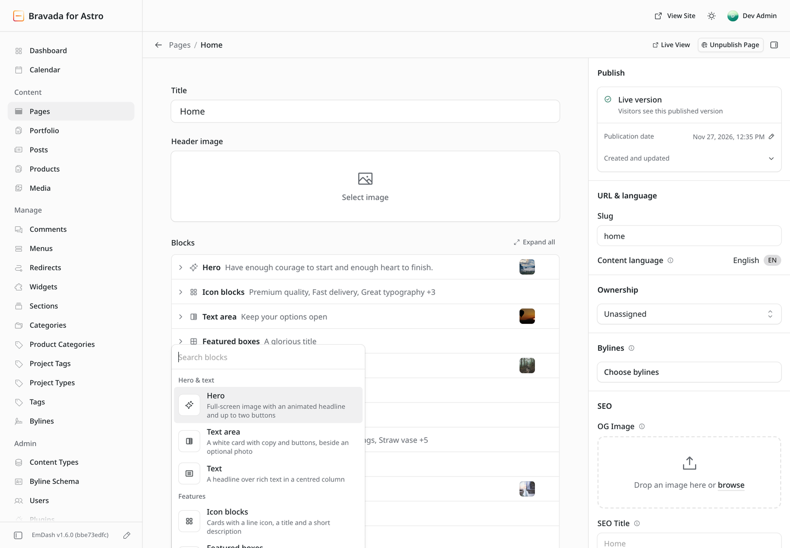

The landing page's composition is content, not code. Each band is a block
in the page's **Blocks** field: pick one from the grouped picker, drag it
into place, and open it to edit its copy, images, buttons and style. Posts,
portfolio, products, menus, widgets and media all live in the same admin at
`/_emdash/admin`.

## Marketing blocks

Thirteen block types, each drawn in Bravada's own idiom. Every one of them
is on the [Marketing blocks](https://bravada.comfus.io/marketing-blocks)
page of the demo; the home page uses the hero, icon blocks, text areas,
featured boxes, portfolio and testimonials.

<table>
<tr><th colspan="2" align="left">Hero & text</th></tr>
<tr>
<td valign="top" width="50%">
<a href=".github/blocks/marketing-hero.jpg">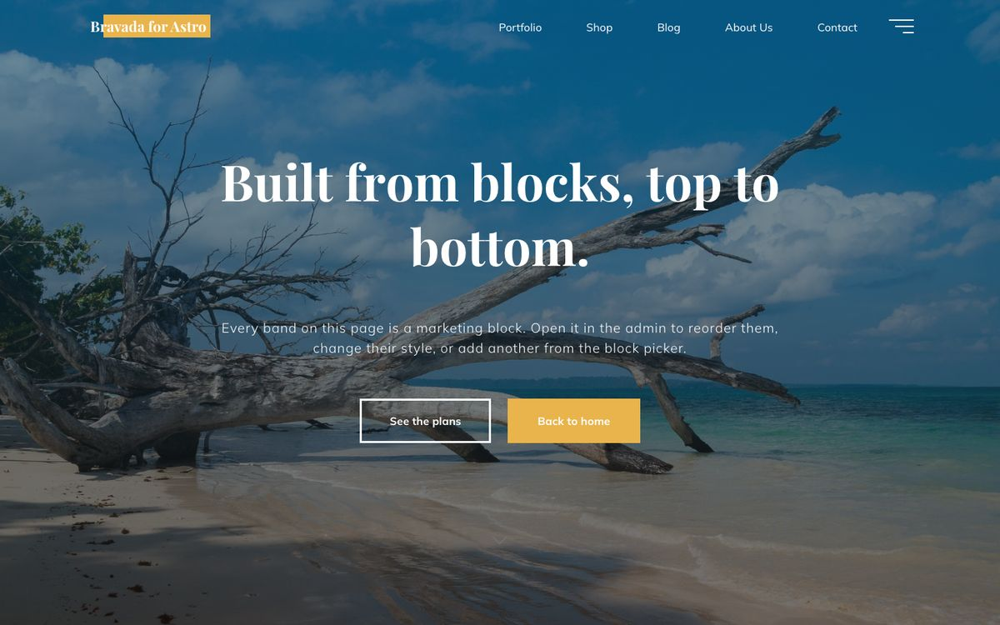</a>
<br><b>Hero</b> · <code>marketing_hero</code><br>
Full-screen photo, a headline whose letters break up in gold, up to two buttons. Pick the letter-effect colour.
</td>
<td valign="top" width="50%">
<a href=".github/blocks/marketing-split.jpg">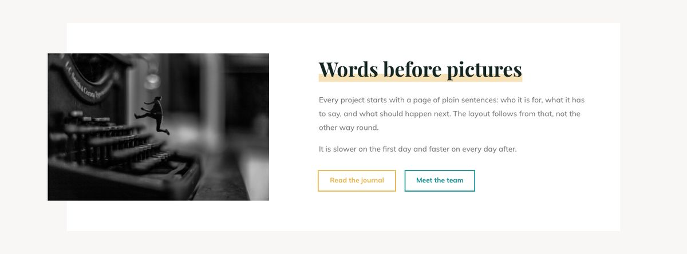</a>
<br><b>Text area</b> · <code>marketing_split</code><br>
A white card on a tinted band, with a photo poking out on either side and outlined buttons.
</td>
</tr>
<tr>
<td valign="top" width="50%">
<a href=".github/blocks/marketing-text.jpg">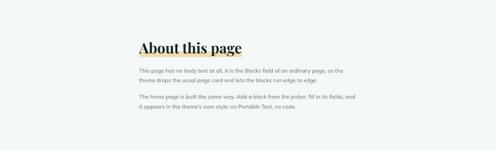</a>
<br><b>Text</b> · <code>marketing_text</code><br>
Rich text in a centred column, for ordinary prose between bands.
</td>
<td width="50%"></td>
</tr>
<tr><th colspan="2" align="left">Features</th></tr>
<tr>
<td valign="top" width="50%">
<a href=".github/blocks/marketing-features.jpg">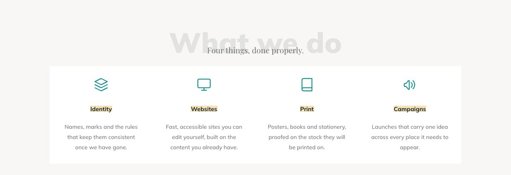</a>
<br><b>Icon blocks</b> · <code>marketing_features</code><br>
Line-icon cards, light or dark, two to four columns. The icons swap on hover.
</td>
<td valign="top" width="50%">
<a href=".github/blocks/bravada-boxes.jpg">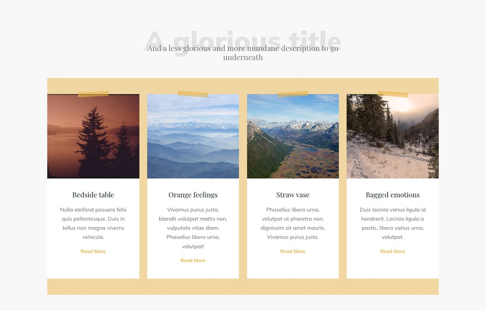</a>
<br><b>Featured boxes</b> · <code>bravada_boxes</code><br>
Image cards in three styles (taped, zoom-under-teal, white overlay) over a gold or teal strip.
</td>
</tr>
<tr>
<td valign="top" width="50%">
<a href=".github/blocks/marketing-stats.jpg">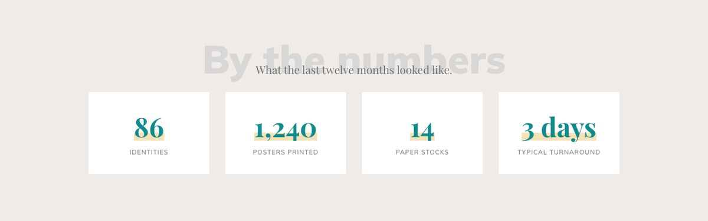</a>
<br><b>Stats</b> · <code>marketing_stats</code><br>
Large Playfair figures with the gold highlighter under them.
</td>
<td width="50%"></td>
</tr>
<tr><th colspan="2" align="left">Showcase</th></tr>
<tr>
<td valign="top" width="50%">
<a href=".github/blocks/bravada-portfolio.jpg">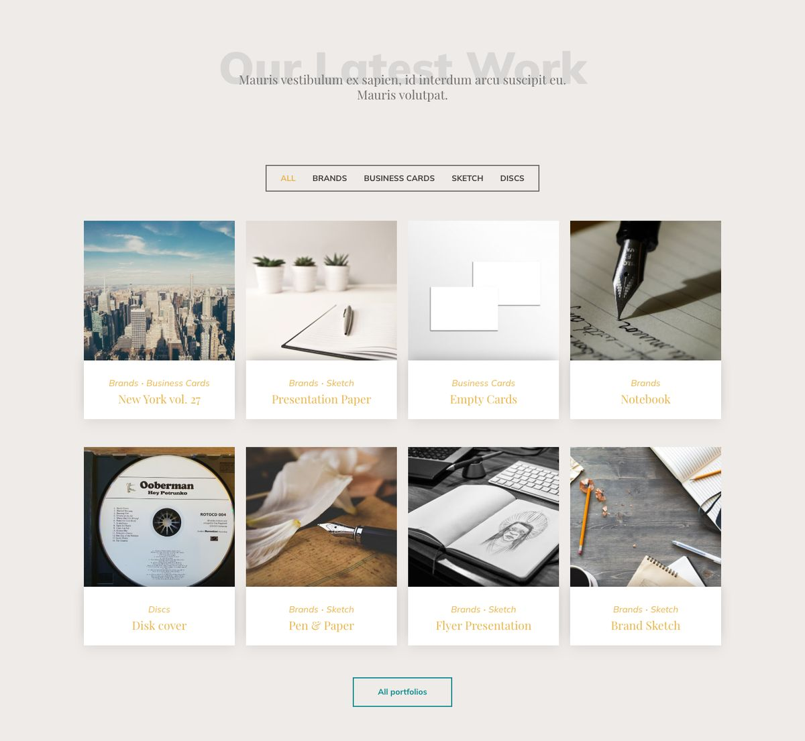</a>
<br><b>Portfolio</b> · <code>bravada_portfolio</code><br>
A project grid with client-side filters drawn from each card's tags.
</td>
<td valign="top" width="50%">
<a href=".github/blocks/marketing-testimonials.jpg">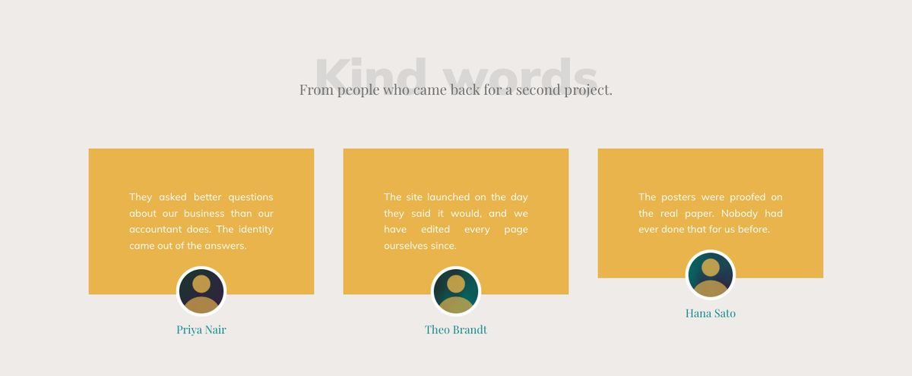</a>
<br><b>Testimonials</b> · <code>marketing_testimonials</code><br>
Gold quote cards with a round portrait pulled over the edge.
</td>
</tr>
<tr>
<td valign="top" width="50%">
<a href=".github/blocks/marketing-logos.jpg"></a>
<br><b>Logos</b> · <code>marketing_logos</code><br>
Client marks in greyscale, coming up to colour on hover; a name alone becomes a wordmark.
</td>
<td width="50%"></td>
</tr>
<tr><th colspan="2" align="left">Conversion</th></tr>
<tr>
<td valign="top" width="50%">
<a href=".github/blocks/marketing-cta.jpg"></a>
<br><b>Call to action</b> · <code>marketing_cta</code><br>
A banner over a photo under a teal scrim, or on the footer's dark green.
</td>
<td valign="top" width="50%">
<a href=".github/blocks/marketing-pricing.jpg">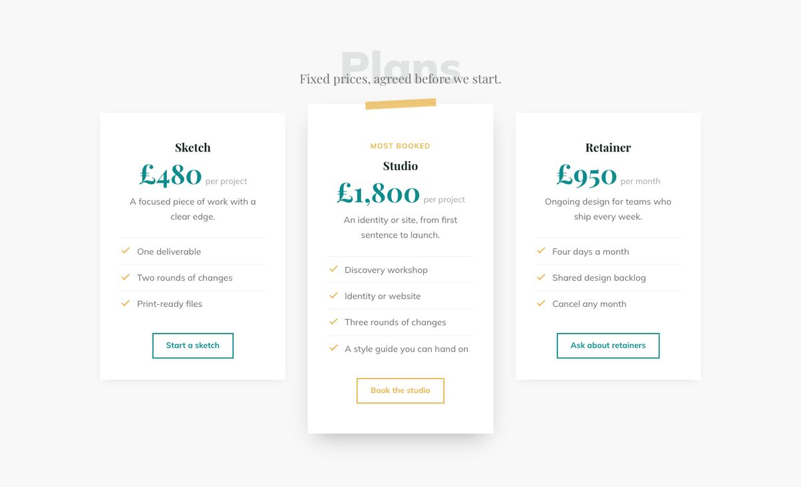</a>
<br><b>Pricing</b> · <code>marketing_pricing</code><br>
Plan cards with a feature list; the highlighted plan wears the gold tape.
</td>
</tr>
<tr>
<td valign="top" width="50%">
<a href=".github/blocks/marketing-faq.jpg">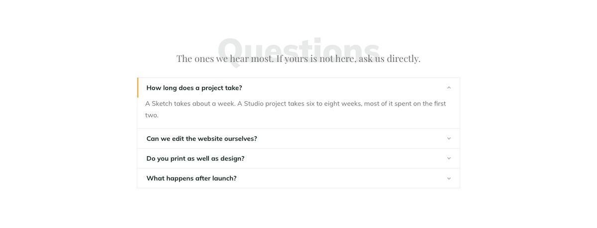</a>
<br><b>FAQ</b> · <code>marketing_faq</code><br>
Questions that open one at a time, beside an optional intro.
</td>
<td valign="top" width="50%">
<a href=".github/blocks/marketing-contact.jpg"></a>
<br><b>Contact options</b> · <code>marketing_contact</code><br>
Ways to get in touch, each with an icon and a link.
</td>
</tr>
</table>

The eleven `marketing_*` types follow the field names of EmDash's marketing
template (`headline`, `subheadline`, `primary_cta_label` and so on), so the
admin lays their forms out well and content moves between the two with
little rework. Where Bravada has a setting the template doesn't, it is an
extra field on the block, and the icon list is Bravada's line set:

| Setting | On | Does |
|---|---|---|
| Letter effect colour | Hero | The colour the headline's letters flash: `bravada`, `ripley`, `sculpt`, `sundown` |
| Style | Icon blocks, featured boxes | `light` / `dark`; `static` / `animated` / `overlay` |
| Columns | Icon blocks, featured boxes, portfolio | Two to four across on desktop |
| Accent strip | Featured boxes | The gold or teal band behind the grid |
| Background tint | Text area, featured boxes, stats, logos, pricing | One of the demo's band colours: `warm`, `stone`, `lilac`, `grey`, `mist` |
| Section ID | Every block | An `id` for in-page links such as `#plans` |

Any page can use blocks, not just the home page. A page built only from
blocks drops the usual page card and runs edge to edge; add body text as
well and the card, with its sidebars, follows the blocks.

**Adding your own block type** takes three steps: define it under
`blockTypes` in the seed, add its slug to the Pages field's `allowedTypes`,
and map its `_type` to a component in `src/components/PageBlocks.astro`.
Typecheck fails if a type has no component. Plan the fields before shipping:
EmDash keeps every block type and version for good (there is no delete), and
a breaking change to a block means a new version, not an edit.

Images in seeded blocks are external media values pointing at files in
`public/images/demo/`, so the seed works on Cloudflare Workers too, where a
seed cannot import local files into the media library. Images an editor picks
in the admin are ordinary media-library items.

## Portable Text blocks

The bands that aren't page sections — sidebar and footer widgets, and the
template pages' contact form, map, team, accordion and shop grid — remain
custom Portable Text block types. Components live in `src/components/blocks/`
and are dispatched by `src/components/RichText.astro`; use that wherever
editor content renders, and every type comes with it.

| Block type | Renders | Seeded on |
|---|---|---|
| `bravada.team` | Team member grid | about-us |
| `bravada.accordion` | Collapsible panels | about-us |
| `bravada.contactform` | Contact form | contact |
| `bravada.map` | Map band | contact |
| `bravada.shopgrid` | Product grid | shop |
| `bravada.postswidget` | Recent posts | `sidebar-b` |
| `bravada.products` | Product list | `page-sidebar` |
| `bravada.search` | Search box | `sidebar-b` |
| `bravada.tabswidget` | Tabbed widget | `sidebar-b` |
| `bravada.widgetportfolio` | Portfolio thumbnails | footer |
| `bravada.projectgrid` | Project grid | used by project archives |
| `bravada.projectfeatured` | Featured project | used by `/portfolio/:slug` |
| `bravada.portfolio` | Portfolio grid band | portfolio, sections |
| `bravada.hero`, `.blocks`, `.boxes`, `.text`, `.testimonials` | The other landing bands | sections only |

These types are not registered with the editor, so it can reorder and delete
them but has no form for their settings, and their image fields take a plain
URL string rather than a media object. The landing bands in the last two
rows render the same components as their marketing-block counterparts; they
stay so that a home page set up before blocks keeps rendering, and so the
portfolio page and the seeded sections below still work.

### Blocks vs sections

A **section** is a saved, reusable group of Portable Text, which an editor
drops into any rich-text field with the `/section` command. The seed ships
nine — `hero-slider`, `icon-blocks`, `icon-blocks-dark`, `text-band`,
`featured-boxes-static`, `featured-boxes-animated`, `portfolio-grid`,
`testimonials` and `footer-portfolio` — as starting points for pages that
are mostly prose. They are independent of the home page: editing a section
changes neither the home page nor any page it was dropped into earlier.

The homepage renders the page with slug `home` full-width above the latest
posts: its blocks, then any rich text in its Content field. Delete or
unpublish the page to fall back to a plain blog front page.

## Structure

- `seed/seed.minimal.json` — the same structure with no demo content, for
  starting a clean site (see First run).
- `seed/seed.json` — four collections (posts, pages, portfolio, products),
  five taxonomies (category, tag, project-type, project-tag,
  product-category), primary/social/mobile menus, sidebar and footer widget
  areas, thirteen marketing block types, nine Bravada sections, and the demo
  content: a `home` landing page and a `marketing-blocks` showcase built
  from blocks, twelve posts, twelve projects, twenty-three products and the
  template pages.
- `src/styles/theme.css` — the Bravada design tokens and signature styles.
  All colors use `light-dark()`; dark mode is automatic.
- `src/styles/tokens.css` — template defaults (don't edit; override in theme.css).

## Pages

| Page | Route |
|---|---|
| Homepage (landing + latest) | `/` |
| All posts | `/posts` (ten per page, `?page=N`) |
| Single post | `/posts/:slug` |
| Category / tag archive | `/category/:slug`, `/tag/:slug` |
| Portfolio project | `/portfolio/:slug` |
| Project type / tag archive | `/project-type/:slug`, `/project-tag/:slug` |
| Product | `/product/:slug` (zoomable gallery: hover lens, click for a magnifier lightbox) |
| Search | `/search` |
| Static pages (about, contact, shop, …) | `/:slug` |

RSS lives at `/rss.xml`; `sitemap.xml` and `robots.txt` are served by the
EmDash integration.

One thing to do once, after seeding: open the **Home** page in the admin and
tick **hide from search engines** in its SEO panel. The landing page is a
real page entry, so it also has a slug — `/home` — which this theme redirects
to `/` the way WordPress redirects a static front page. The sitemap is built
from content rather than routes, though, so without that flag it lists
`/home` and search engines are handed a URL that only redirects. The flag
removes it from the sitemap and leaves `/` untouched, because the home route
doesn't read per-entry SEO. There is no seed field for it, which is why it
can't ship pre-set.

### Let crawlers reach your images

The default `robots.txt` disallows `/_emdash/`, which is where EmDash's
media proxy serves uploads from (`/_emdash/api/media/file/…`). Anything
you upload through the admin is served from that path — `getMediaUrl` in
`src/utils/media-url.ts` builds those URLs — so it sits behind the
Disallow.

**This may not affect you at all.** Images shipped in `public/`, as this
theme's demo images are, come from the site root and the rule never
touches them. On-page images going through Astro's image endpoint, an
external provider such as Cloudflare Images, or a public R2 or CDN origin
are outside `/_emdash/` too. Check what your pages actually emit before
changing anything.

The exception is social previews. This theme builds `og:image` from the
stored path made absolute, with no transform, so a media-library upload
used as a preview image is still served from `/_emdash/api/media/file/…`
even on a site whose on-page images are all transformed.

If you do need the fix, it goes in the site settings SEO panel (the
`seo.robotsTxt` field), which EmDash serves verbatim in place of its
default:

```
User-agent: *
Allow: /

# Uploaded images sit under the admin prefix. Allow them by extension, so
# nothing else served from that path becomes crawlable with them.
Allow: /_emdash/api/media/file/*.avif$
Allow: /_emdash/api/media/file/*.gif$
Allow: /_emdash/api/media/file/*.jpeg$
Allow: /_emdash/api/media/file/*.jpg$
Allow: /_emdash/api/media/file/*.png$
Allow: /_emdash/api/media/file/*.svg$
Allow: /_emdash/api/media/file/*.webp$

# Admin UI, content API and auth routes stay out of the index.
Disallow: /_emdash/
```

Listing extensions rather than allowing the whole media path matters
because the proxy serves *every* uploaded file type from that prefix —
a blanket `Allow` would put PDFs and any other upload into the index
alongside the images.

Google resolves a conflict between `Allow` and `Disallow` by the longest
matching path, so these rules win while everything else under `/_emdash/`
stays blocked. `*` and `$` are widely supported but not universal; a
crawler that ignores them simply falls back to the Disallow, which is the
behaviour you have today. Media URLs carry no query string, so the `$`
anchor matches. You don't need a `Sitemap:` line — EmDash appends one when
your text doesn't already name it.

## Architecture

Everything is server-rendered (`output: "server"`): content lives in SQLite
and pages query it per request, so edits in the admin are live immediately —
no rebuilds.

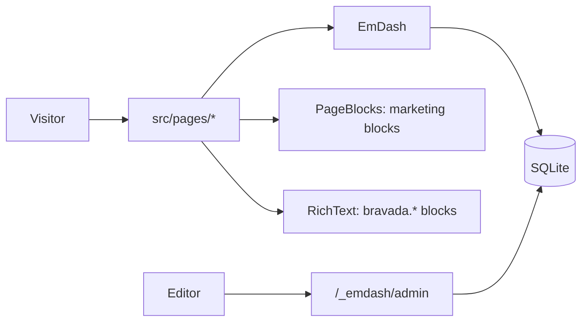

The theme layer is deliberately thin: routes in `src/pages/` query EmDash,
hand a page's Blocks field to `PageBlocks.astro` and its Portable Text to
`RichText.astro`, and both draw with the same band components in
`src/components/blocks/`. Design tokens in `src/styles/theme.css` restyle
the base template without touching its layout primitives.

## First run

Start from a clean copy — either click **Use this template** on GitHub, or:

```bash
npm create astro@latest -- --template vhscom/emdash-theme-bravada
```

Requires **Node 22+** and **pnpm** (fonts are fetched from Google at build
time, so the first build needs network access).

```bash
pnpm install
pnpm dev                          # localhost:4321 — migrations run, but the site starts EMPTY
```

Then visit `http://localhost:4321/_emdash/admin` — the setup wizard creates
your first admin account and offers **"Include sample content"**, which
applies the full Bravada demo seed for you. Prefer the command line?

```bash
npx emdash seed seed/seed.json    # same thing, without the wizard checkbox
```

Prefer to skip the demo content? Seed the structure only (collections,
taxonomies, menus, widget areas, sections — no posts, shop, or portfolio):

```bash
npx emdash seed seed/seed.minimal.json
```

To start over at any point: stop the dev server, `rm data.db*`, and run
`pnpm dev` again.

Full-text search, RSS, sitemap/robots, SEO/JSON-LD, comments-ready routes,
dark/light mode and the audit-log plugin come from EmDash and the underlying
blog template.

## Make it yours

- **Site title, tagline, logo** live in the CMS, not the code: admin →
  Settings. The header wordmark, footer, RSS feed, and meta titles all follow.
- **Menus and widgets** are admin-editable (Appearance → Menus / Widgets);
  the seed's `primary`, `social`, and `mobile` menus are starting points.
- **Colours and fonts**: override tokens in `src/styles/theme.css` (see the
  notes at the top of that file); webfonts are configured in
  `astro.config.mjs`. Don't edit `src/styles/tokens.css`.

  Every colour is declared with `light-dark(<light>, <dark>)`, so each token
  carries both modes and there is no separate dark palette to maintain —
  overriding with a plain colour changes both at once. The tokens worth
  knowing: `--color-brand` / `--color-brand-hover` / `--color-on-brand`,
  `--color-bg` / `--color-surface` / `--color-text` / `--color-border`,
  `--font-body` / `--font-heading` / `--font-display` / `--font-mono`,
  `--content-width` (680px article column), `--wide-width` (1200px), and
  `--sidebar-width` (320px).

  > **A note before you "fix" the contrast:** the palette deliberately
  > reproduces the original Bravada demo — gold `#E9B44C` and teal `#0F8B8D`
  > — rather than meeting WCAG AA contrast. That's a fidelity decision, not
  > an oversight. Everything else in the theme (focus order, landmarks,
  > keyboard operation, reduced motion) does target AA.
- **Post-page furniture**: admin → Plugins → Bravada Theme toggles the
  post author attribution and the docked prev/next buttons (see Theme
  settings below).

## Deploy

The template builds to a self-hosted Node server:

```bash
pnpm build
node ./dist/server/entry.mjs   # honours HOST / PORT env vars
```

Production checklist:

1. **Set the Site URL** (admin → Settings) — canonicals, Open Graph URLs,
   the sitemap, and the RSS feed all derive absolute URLs from it.
2. **Generate an encryption key**: `npx emdash secrets generate` and set
   `EMDASH_ENCRYPTION_KEY` in the server environment (encrypts plugin
   secrets at rest).
3. **Persist `data.db*` and `uploads/`** — both live on disk; put them on a
   volume that survives restarts and back them up together.

### Cloudflare Workers

The live demo runs from the `deploy/cloudflare` branch, which swaps the Node
adapter for `@astrojs/cloudflare` and backs the site with D1, KV, and R2
(`wrangler.jsonc`). Keep `emdash` and `@emdash-cms/cloudflare` on the same
version — a mismatch surfaces at runtime, not at build time.

That branch pins `vite` and `rolldown` via `overrides` in
`pnpm-workspace.yaml`. Newer rolldown emits a bare `require("path")` shim for
CJS dependencies that throws at module init under workerd, which a successful
`astro build` will not catch. Smoke-test the built Worker before deploying:

```bash
npx wrangler dev        # runs the real Workers runtime locally
npx wrangler deploy
```

For other targets (Postgres, S3 storage) see the
[EmDash deployment docs](https://docs.emdashcms.com).

The demo's database also has **D1 read replication** turned on, which no
repository can carry for you. `session: "auto"` is already in the deploy
branch's config, but that alone does nothing until replication is enabled on
the database itself (Cloudflare dashboard → **Storage & Databases** → **D1**
→ your database → **Settings** → **Enable Read Replication**). It is optional
and currently in beta; skip it unless your readers are far from your
database's region.

### Caching

On the Cloudflare deploy, rendered pages are cached at the edge and content
edits purge the pages that showed them. Two documentation pages are the
reference and stay current when this file will not:
[Deploy to Cloudflare → Workers Cache](https://docs.emdashcms.com/deployment/cloudflare/)
and [Object Cache](https://docs.emdashcms.com/deployment/object-cache/).

**Set this before you deploy, or half of the caching below does not work.**
In the Cloudflare dashboard, open your domain → **Caching** →
**Configuration** → **Browser Cache TTL**, and set it to **Respect Existing
Headers**. The theme tells each page how long a browser may keep it; the zone
has its own value for that, defaulting to four hours, and Cloudflare serves
whichever of the two is *higher*. So without this the theme's five minutes
becomes four hours on the way out, an edit stays invisible to returning
readers for that long, and no purge reaches a browser to fix it. It is easy
to miss because it shows only on cached responses — a cache-busted request
passes the theme's own value straight through and looks correct.

What this theme does today:

- **Pages are cached in front of the site, not inside it.** Two tiers sit
  ahead of the Worker, so a reader is answered from their nearest data
  centre and the site never runs. Measured on a sister site: a cached page
  went from roughly 400ms to 95ms for a reader on the other side of the
  world.
- **Pages are held for an hour**, and for ten days after that a reader gets
  the stored copy immediately while a fresh one is fetched behind them.
  Publishing clears the pages an entry appears on, so that window bounds
  only the things tags cannot see — site settings, menus, and the theme
  itself. Change it in `routeRules` in `astro.config.mjs`.
- **No secrets needed.** Purging happens from inside the Worker. Earlier
  versions used the Cloudflare REST API and needed `CF_ZONE_ID` and a
  cache-purge token; if you set those up for this theme, nothing reads them
  any more.
- **Every route you add has to state how it should be cached.** A page that
  says nothing is not left alone — it is cached anyway, on whatever the host
  guesses. Add a rule for it in `routeRules`.
- **To keep a route out of the cache, give it `maxAge: 0` in `routeRules`.**
  `/search` is the example. Do not reach for `Astro.cache.set(false)` in the
  page: HTML streams, so the footer's own cache hint runs afterwards and
  clears it, and `set(false)` also wipes the rule you set. The two together
  produce a page offered to the cache with no lifetime at all, which is read
  as roughly two hours — the opposite of what you asked for. A rule survives,
  because a hint only ever adds tags and never changes the lifetime.
- **Pages that query content call `Astro.cache.set(cacheHint)`**, which is
  what lets a publish purge exactly the pages that showed an entry. On the
  Node build there is no cache provider, so those calls do nothing and cost
  nothing.

**Smoke-test a deploy with a cache buster, then check the plain URL.** After
`wrangler deploy` the plain URL keeps serving the previously cached page for
up to the hour above, which references the `/_astro/*` filenames of the build
before it — so a fix you just shipped can look unshipped, or the page can
arrive unstyled. Fetch `?bust=<random>` to learn the current build's asset
hash, then check the plain URL against it. A client `Cache-Control: no-cache`
is ignored inside that window, so an instant flush means purging from the
Cloudflare dashboard.

### Working against a deployed site

The CLI can talk to a live site, not just a local one, which beats editing
the database underneath it — writes go through the site's own API, so
revisions and cache invalidation are handled for you. Sign in once:

```bash
npx emdash login --url https://your-site.example.com
```

It prints a code and a URL (`/_emdash/admin/device`); open that in a
browser, enter the code, and authenticate as you normally would. The token
is saved to `~/.config/emdash/auth.json`, so from then on any remote
command just needs `--url`:

```bash
npx emdash content list posts --url https://your-site.example.com
npx emdash schema get products --url https://your-site.example.com
npx emdash types --url https://your-site.example.com
```

Two things to know before you rely on it:

- **Updating content writes a draft, it does not publish.** The entry shows
  as "published with pending changes" in the admin and the public page keeps
  serving the previous version until you follow up with
  `emdash content publish`. Easy to mistake for a caching problem.
- **The CLI cannot create every field type.** `schema add-field` takes no
  sub-fields and no select options, so a repeater or a select has to be built
  from **Content Types** in the admin. It *can* delete such a field, which is
  a good way to strand yourself — check you can rebuild a field before
  removing it.

## Theme settings

Post-page display toggles live in a template-local plugin
(`src/plugins/bravada-theme/`) and are edited in the admin:
**Plugins → Bravada Theme**. Changes apply immediately — no restart, no
seed edits.

- **Show post author** (default on) — post pages attribute content to
  the byline in three places: the avatar + name chip in the post hero, the
  byline in the article meta line, and the author card below the article.
  For a single-author site where attribution is noise, turn all three off.
  The hero excerpt (the entry's Excerpt field, which is also the
  search-engine description) is independent of author display — it keeps
  rendering, exactly as Bravada treats its excerpt and author-meta options
  as separate toggles.
- **Show prev/next buttons** (default on) — the docked buttons that fade
  in beside the article on scroll (demo `#nav-fixed`). Turning them off
  leaves the full-bleed previous/next image band above the footer intact.

## Documentation

- [EmDash docs](https://docs.emdashcms.com) — querying content, schema,
  menus, widgets, plugins, deployment.
- [EmDash docs MCP](https://docs.emdashcms.com/docs-mcp) — this repo ships
  `.mcp.json` / `.cursor/mcp.json` / `.vscode/mcp.json`, so Claude Code,
  Cursor, and VS Code can search the EmDash docs while you work.
- [Astro docs](https://docs.astro.build) — the underlying framework.
- [Bravada](https://www.cryoutcreations.eu/wordpress-themes/bravada) — the
  upstream WordPress theme this port is matched against.

## License

© 2026 vhs. A port of Bravada, © 2020–25
[Cryout Creations](https://www.cryoutcreations.eu). Licensed under
GPL-3.0-or-later — see [LICENSE](./LICENSE) for the full text and
[CREDITS.md](./CREDITS.md) for attribution details.

Maintained by vhs at [Comfusion](https://comfus.io).
